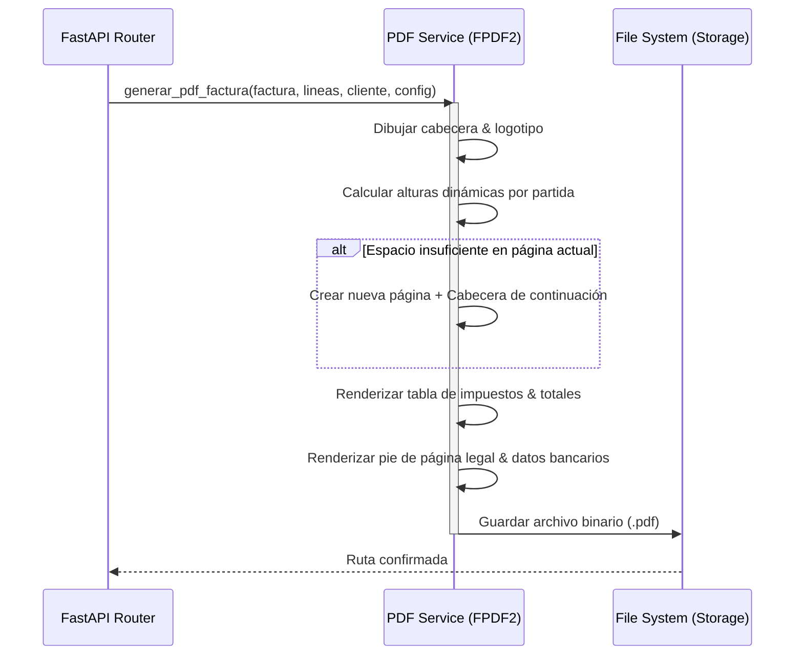

# Plan Maestro de Pruebas (SIF PyME)

> **Documento de Especificación y Estrategia de Calidad de Software**  
> **Versión:** 2.0  
> **Fecha:** 20 de Octubre de 2026  
> **Entorno:** Local Desktop (AppKit / macOS Style & Webview)  
> **Stack:** FastAPI, SQLite (WAL Mode), FPDF2 / ReportLab, Vanilla JS (Apple HIG)

---

## Índice

1. [Objetivo y Alcance](#1-objetivo-y-alcance)
2. [Estrategia y Pirámide de Pruebas](#2-estrategia-y-pirámide-de-pruebas)
3. [Matriz de Cobertura por Módulo](#3-matriz-de-cobertura-por-módulo)
   - [3.1. Configuración Fiscal y Textos Editoriales](#31-configuración-fiscal-y-textos-editoriales)
   - [3.2. Clientes y Directorio](#32-clientes-y-directorio)
   - [3.3. Catálogo de Productos y Servicios](#33-catálogo-de-productos-y-servicios)
   - [3.4. Presupuestos y Opciones](#34-presupuestos-y-opciones)
   - [3.5. Facturación y Emisión Oficial](#35-facturación-y-emisión-oficial)
   - [3.6. Conversión de Presupuesto a Factura](#36-conversión-de-presupuesto-a-factura)
   - [3.7. Historial de Versiones (Time Machine)](#37-historial-de-versiones-time-machine)
   - [3.8. Papelera de Reciclaje y Recuperación](#38-papelera-de-reciclaje-y-recuperación)
   - [3.9. Copias de Seguridad (Disaster Recovery)](#39-copias-de-seguridad-disaster-recovery)
   - [3.10. Paginación Integral y Navegación](#310-paginación-integral-y-navegación-de-grandes-volúmenes)
   - [3.11. Módulo de Descuentos Comerciales](#311-módulo-de-descuentos-comerciales-y-promociones)
   - [3.12. Asistente de Configuración Inicial (Onboarding)](#312-asistente-de-configuración-inicial-onboarding)
   - [3.13. Numeración Estructurada y Unificada Con/Sin IVA](#313-numeración-estructurada-y-unificada-consin-iva)
4. [Casos Extremos, Límite y Complejos (Edge Cases)](#4-casos-extremos-límite-y-complejos-edge-cases)
5. [Pruebas de Generación de Documentos PDF](#5-pruebas-de-generación-de-documentos-pdf)
6. [Pruebas de Interfaz de Usuario (Apple HIG)](#6-pruebas-de-interfaz-de-usuario-apple-hig)
7. [Guía de Ejecución de Pruebas](#7-guía-de-ejecución-de-pruebas)

---

## 1. Objetivo y Alcance

El presente plan define la metodología, escenarios, matrices y casos de prueba necesarios para validar la totalidad de las funcionalidades de **SIF PyME**. Garantiza:
- Exactitud matemática y legal en el cálculo de impuestos (IVA, IRPF, recargos y descuentos) según la normativa tributaria española.
- Trazabilidad e inmutabilidad en la emisión contable y en el versionado histórico.
- Integridad referencial de datos en SQLite local (incluso ante cierres abruptos o caídas del sistema).
- Consistencia con las *Human Interface Guidelines* de Apple en la interfaz de usuario.

---

## 2. Estrategia y Pirámide de Pruebas

```
                  / \
                 /   \      E2E / Pruebas de Interfaz Manual
                / UI  \     (Sheets modales, autocompletados, macOS HIG)
               /-------\
              /  Integ  \   Pruebas de Integración de API
             /  Backend  \  (FastAPI TestClient, SQLite temporal, PDFs)
            /-------------\
           /   Unitarias   \ Cálculos de redondeo, validadores de NIF,
          /  Matemáticas    \ modelos Pydantic y serialización
         /-------------------\
```

- **Pruebas Unitarias**: Funciones puras de cálculo (`app/services/pdf_service.py`), validadores de NIF/CIF/NIE (`app/validators.py`).
- **Pruebas de Integración (API)**: Endpoints REST con base de datos SQLite aislada y volátil en cada ejecución (`tests/conftest.py`).
- **Pruebas de Regresión**: Verificación de incidencias históricas (desbordamiento de páginas en presupuestos, limpieza de autocompletado en catálogo, preservación de contadores).

---

## 3. Matriz de Cobertura por Módulo

### 3.1. Configuración Fiscal y Textos Editoriales

| ID | Método | Endpoint / Componente | Descripción del Escenario | Resultado Esperado |
|---|---|---|---|---|
| **CFG-01** | `GET` | `/api/configuracion` | Obtener configuración inicial en base de datos limpia. | Devuelve estructura con valores por defecto y `es_valida: false`. |
| **CFG-02** | `PUT` | `/api/configuracion` | Guardar emisor con NIF válido (CIF letra B). | HTTP 200, configuración actualizada y `es_valida: true`. |
| **CFG-03** | `PUT` | `/api/configuracion` | Intentar guardar emisor con NIF no válido (ej. `12345678A`). | HTTP 422 con mensaje descriptivo de NIF erróneo. |
| **CFG-04** | `GET` | `/api/configuracion/presupuesto` | Obtener textos editoriales de presupuesto. | HTTP 200, devuelve textos de bienvenida, condiciones y fases 1 a 4. |
| **CFG-05** | `PUT` | `/api/configuracion/presupuesto` | Modificar fases del proceso y condiciones con saltos de línea. | HTTP 200, textos persistidos conservando formato multilínea. |

---

### 3.2. Clientes y Directorio

| ID | Método | Endpoint / Componente | Descripción del Escenario | Resultado Esperado |
|---|---|---|---|---|
| **CLI-01** | `POST` | `/api/clientes` | Crear cliente empresa con CIF válido (`B12345674`). | HTTP 201, ID generado, NIF normalizado a mayúsculas. |
| **CLI-02** | `POST` | `/api/clientes` | Crear cliente particular (sin NIF o NIF vacío). | HTTP 201, creado correctamente permitiendo `nif_cif: null`. |
| **CLI-03** | `POST` | `/api/clientes` | Intentar registrar dos clientes distintos con el mismo NIF activo. | HTTP 409 Conflict, indicando que el NIF ya está en uso. |
| **CLI-04** | `GET` | `/api/clientes?q=...` | Búsqueda parcial por razón social, teléfono, CIF o email. | HTTP 200, lista filtrada case-insensitive. |
| **CLI-05** | `PUT` | `/api/clientes/{id}` | Actualizar datos fiscales y dirección de un cliente. | HTTP 200, datos actualizados sin afectar facturas ya emitidas. |
| **CLI-06** | `GET` | `/api/clientes/{id}/asociados` | Consultar histórico de facturas y presupuestos vinculados. | HTTP 200 con conteos y listado de IDs asociados. |
| **CLI-07** | `DELETE` | `/api/clientes/{id}` | Eliminación lógica de cliente con facturas y presupuestos. | HTTP 200, cliente y sus documentos asociados pasan a `is_deleted = 1`. |
| **CLI-08** | `POST` | `/api/clientes/{id}/restaurar` | Restaurar cliente previamente eliminado. | HTTP 200, cliente y sus facturas/presupuestos vuelven a estado activo. |

---

### 3.3. Catálogo de Productos y Servicios

| ID | Método | Endpoint / Componente | Descripción del Escenario | Resultado Esperado |
|---|---|---|---|---|
| **PRD-01** | `POST` | `/api/productos` | Crear producto completo (código, nombre, descripción, precio, IVA). | HTTP 201, persistido con precio base e IVA por defecto. |
| **PRD-02** | `POST` | `/api/productos` | Crear producto en lote (Array JSON para Bruno/Postman). | HTTP 201, lista de productos insertados en una sola transacción. |
| **PRD-03** | `POST` | `/api/productos` | Intentar crear producto con código duplicado. | HTTP 409 Conflict por unicidad de código. |
| **PRD-04** | `GET` | `/api/productos?q=tarjeton` | Búsqueda por término parcial coincidente en nombre o descripción. | HTTP 200 con coincidencias ordenadas alfabéticamente. |
| **PRD-05** | `PUT` | `/api/productos/{id}` | Actualizar precio base e IVA de un producto existente. | HTTP 200, producto modificado sin alterar documentos históricos. |
| **PRD-06** | `DELETE` | `/api/productos/{id}` | Eliminación de producto del catálogo. | HTTP 200, producto marcado como `is_deleted = 1`. |
| **PRD-07** | `POST` | `/api/productos` | Crear producto con tramos de cantidad por volumen (`escalados`) y variantes de color/acabado (`variantes`). | HTTP 201, persistencia atómica relacional con cascada. |
| **PRD-08** | `GET` | `/api/productos/{id}/precio-volumen?cantidad=X&variante_id=Y` | Cálculo dinámico del precio unitario sugerido combinando tramo de volumen y recargo de variante. | HTTP 200, precio exacto redondeado a 4 decimales. |
| **PRD-09** | `POST` | `/api/productos` | Intentar crear tramo con `cantidad_maxima < cantidad_minima`. | HTTP 422 Unprocessable Entity por validador Pydantic. |

---

### 3.4. Presupuestos y Opciones

| ID | Método | Endpoint / Componente | Descripción del Escenario | Resultado Esperado |
|---|---|---|---|---|
| **PRE-01** | `GET` | `/api/presupuestos/siguiente-numero` | Sugerir correlativo automático de presupuesto. | Devuelve formato `YYYY-MM-DD-numero` secuencial. |
| **PRE-02** | `POST` | `/api/presupuestos` | Crear presupuesto con 3 opciones distintas y partidas múltiples. | HTTP 200, crea cabecera, 3 opciones, partidas y versión v1. |
| **PRE-03** | `POST` | `/api/presupuestos` | Crear presupuesto con título y subtítulo vacíos. | HTTP 200, aplica automáticamente títulos estándar del sistema. |
| **PRE-04** | `POST` | `/api/presupuestos` | Intentar crear presupuesto con número duplicado. | HTTP 409 Conflict. |
| **PRE-05** | `PUT` | `/api/presupuestos/{id}` | Modificar líneas, añadir opción B y alterar precios. | HTTP 200, recálculo de subtotales y generación de versión v2. |
| **PRE-06** | `DELETE` | `/api/presupuestos/{id}` | Borrar presupuesto no facturado. | HTTP 200, pasa a papelera (`is_deleted = 1`). |
| **PRE-07** | `DELETE` | `/api/presupuestos/{id}` | Intentar borrar presupuesto ya facturado. | HTTP 400 BusinessRuleError impidiendo la eliminación. |
| **PRE-08** | `GET` | `/api/presupuestos/{id}/pdf` | Generación y descarga del PDF editorial. | HTTP 200 `application/pdf`, renderizado con portada, opciones y condiciones. |

---

### 3.5. Facturación y Emisión Oficial

| ID | Método | Endpoint / Componente | Descripción del Escenario | Resultado Esperado |
|---|---|---|---|---|
| **FAC-01** | `POST` | `/api/facturas` | Emitir factura sin datos del emisor configurados. | HTTP 400 BusinessRuleError exigiendo configurar la empresa. |
| **FAC-02** | `POST` | `/api/facturas` | Emitir factura con líneas válidas, descuento (5%), IVA (21%) e IRPF (15%). | HTTP 201, redondeo `ROUND_HALF_UP`, serie oficial, PDF y versión v1. |
| **FAC-03** | `POST` | `/api/facturas` | Intentar emitir factura sin partidas (líneas vacías). | HTTP 422 Unprocessable Entity. |
| **FAC-04** | `POST` | `/api/facturas` | Intentar fecha de vencimiento anterior a la fecha de emisión. | HTTP 422 Unprocessable Entity. |
| **FAC-05** | `PUT` | `/api/facturas/{id}` | Modificar factura emitida (añadir línea y cambiar fecha). | HTTP 200, recálculo, regeneración de PDF y registro de versión v2. |
| **FAC-06** | `PUT` | `/api/facturas/{id}/estado` | Cambiar estado a `'Pagada'`, `'Emitida'`, `'Vencida'` o `'Anulada'`. | HTTP 200, estado actualizado y registrado en historial de versiones. |
| **FAC-07** | `DELETE` | `/api/facturas/{id}` | Eliminar factura emitida. | HTTP 200, movida a papelera (`is_deleted = 1`), desvincula presupuestos asociados. |
| **FAC-08** | `GET` | `/api/facturas/{id}/pdf` | Descarga de PDF oficial de la factura. | HTTP 200 `application/pdf` con emisor congelado (snapshot) y diseño HIG. |
| **FAC-09** | `POST` | `/api/facturas` | Emitir factura con casillas separadas de `descripcion` y `detalle_material`. | HTTP 201, persistencia en columnas independientes de `lineas_factura`. |
| **FAC-10** | `PUT` | `/api/facturas/{id}` | Modificar factura preservando casillas separadas sin inyectar paréntesis artificiales `(detalle)`. | HTTP 200, separación automática en edición y renderizado limpio en PDF. |

---

### 3.6. Conversión de Presupuesto a Factura

| ID | Método | Endpoint / Componente | Descripción del Escenario | Resultado Esperado |
|---|---|---|---|---|
| **CNV-01** | `POST` | `/api/presupuestos/{id}/convertir-a-factura` | Convertir seleccionando la Opción B entre 3 opciones disponibles. | Factura creada **únicamente** con las líneas de la Opción B. Presupuesto pasa a `'Facturado'`. |
| **CNV-02** | `POST` | `/api/presupuestos/{id}/convertir-a-factura` | Reintentar convertir un presupuesto ya facturado. | HTTP 400 BusinessRuleError indicando que ya está facturado. |
| **CNV-03** | `POST` | `/api/presupuestos/{id}/convertir-a-factura` | Convertir aplicando retención de IRPF personalizada (15%). | Factura emitida calcula la base, el IVA y descuenta la retención de IRPF. |
| **CNV-04** | `GET` | `/api/presupuestos/{id}/pdf` | Generar PDF de presupuesto después de ser convertido. | El PDF muestra badge "Aprobada" en la Opción B y "No aprobada" en las restantes. |

---

### 3.7. Historial de Versiones (Time Machine)

| ID | Método | Endpoint / Componente | Descripción del Escenario | Resultado Esperado |
|---|---|---|---|---|
| **VER-01** | `GET` | `/api/facturas/{id}/versiones` | Consultar versiones de factura tras crear y editar. | Lista ordenada DESC con `v2` (actual) y `v1` (inicial). |
| **VER-02** | `GET` | `/api/facturas/{id}/versiones/{num}` | Consultar detalle de una versión específica. | Devuelve snapshot completo (factura, partidas y cliente). |
| **VER-03** | `POST` | `/api/facturas/{id}/versiones/{num}/restaurar` | Restaurar factura a la versión v1 cuando está en v3. | Se genera versión v4 con los datos exactos de v1. Preserva trazabilidad. |
| **VER-04** | `GET` | `/api/presupuestos/{id}/versiones` | Consultar versiones de presupuesto tras múltiples modificaciones. | Lista cronológica con total estimado y desglose de opciones. |
| **VER-05** | `POST` | `/api/presupuestos/{id}/versiones/{num}/restaurar` | Restaurar presupuesto a versión anterior. | Opciones y líneas se restauran idénticas a la versión elegida. |

---

### 3.8. Papelera de Reciclaje y Recuperación

| ID | Método | Endpoint / Componente | Descripción del Escenario | Resultado Esperado |
|---|---|---|---|---|
| **PAP-01** | `GET` | `/api/papelera` | Listar elementos eliminados con facturas y presupuestos en papelera. | HTTP 200 con arrays separados y `total_items`. |
| **PAP-02** | `POST` | `/api/facturas/{id}/restaurar` | Recuperar factura desde la papelera. | Factura pasa a `is_deleted = 0`, desaparece de papelera y reaparece activa. |
| **PAP-03** | `POST` | `/api/presupuestos/{id}/restaurar` | Recuperar presupuesto desde la papelera. | Presupuesto pasa a `is_deleted = 0` y vuelve al listado activo. |
| **PAP-04** | `DELETE` | `/api/facturas/{id}/destruir` | Destrucción física definitiva de factura en papelera. | Fila eliminada permanentemente de la base de datos SQLite. |
| **PAP-05** | `DELETE` | `/api/presupuestos/{id}/destruir` | Destrucción física definitiva de presupuesto. | Presupuesto, opciones y líneas borrados permanentemente. |
| **PAP-06** | `POST` | `/api/papelera/vaciar` | Vaciar papelera con múltiples documentos. | Todas las filas con `is_deleted = 1` son purgadas. Contador vuelve a 0. |

---

### 3.9. Copias de Seguridad (Disaster Recovery)

| ID | Método | Endpoint / Componente | Descripción del Escenario | Resultado Esperado |
|---|---|---|---|---|
| **BAK-01** | `GET` | `/api/backups` | Listar snapshots disponibles en la carpeta de respaldos. | Lista de archivos `.db` con tamaño en bytes y fecha legible. |
| **BAK-02** | `POST` | `/api/backups/snapshot` | Solicitar creación de respaldo manual de la base de datos. | Snapshot generado mediante SQLite Online Backup API sin bloquear lecturas. |
| **BAK-03** | `POST` | `/api/backups/{filename}/restaurar` | Restaurar base de datos a un snapshot anterior. | Genera backup preventivo `pre_restore`, sobrescribe base de datos y resetea pool. |

---

### 3.10. Paginación Integral y Navegación de Grandes Volúmenes

| ID | Método | Endpoint / Componente | Descripción del Escenario | Resultado Esperado |
|---|---|---|---|---|
| **PAG-01** | `GET` | `/api/facturas` | Modo retrocompatible sin `paginated=true`. | HTTP 200 array plano de facturas + cabeceras `X-Total-Count`, `X-Page`, `X-Page-Size`, `X-Total-Pages`. |
| **PAG-02** | `GET` | `/api/facturas?paginated=true&page=1&page_size=25` | Paginación estructurada en Facturas. | HTTP 200 `{ items: [...], total, page: 1, page_size: 25, total_pages }`. |
| **PAG-03** | `GET` | `/api/presupuestos?paginated=true` | Paginación estructurada en Presupuestos. | HTTP 200 `{ items: [...], total, page, page_size, total_pages }`. |
| **PAG-04** | `GET` | `/api/clientes?paginated=true` | Paginación estructurada en Directorio de Clientes. | HTTP 200 `{ items: [...], total, page, page_size, total_pages }`. |
| **PAG-05** | `GET` | `/api/productos?paginated=true` | Paginación estructurada en Catálogo de Productos. | HTTP 200 `{ items: [...], total, page, page_size, total_pages }` con variantes y escalados por volumen. |
| **PAG-06** | UI | Barra de Estado macOS (`MacPagination`) | Control de navegación en statusbar de las 4 vistas (`/`, `/presupuestos`, `/clientes`, `/productos`). | Selector de tamaño (25, 50, 100 / pág.), botones Anterior/Siguiente deshabilitados en límites, indicador `Página X / Y`. |

---

### 3.11. Módulo de Descuentos Comerciales y Promociones

| ID | Método | Endpoint / Componente | Descripción del Escenario | Resultado Esperado |
|---|---|---|---|---|
| **DSC-01** | `POST` | `/api/descuentos` | Crear descuento global en porcentaje (10%) para todos los productos. | HTTP 201, descuento persistido con `aplica_a: "todos"`. |
| **DSC-02** | `POST` | `/api/descuentos` | Crear descuento específico vinculado a productos seleccionados. | HTTP 201, registros creados en `descuento_productos` con `aplica_a: "productos"`. |
| **DSC-03** | `GET` | `/api/descuentos?paginated=true` | Listado de descuentos con precarga en lote (Batch Loading). | HTTP 200, devuelve array sin consultas N+1 con nombres de productos asociados. |
| **DSC-04** | `POST` | `/api/facturas` | Emitir factura con descuento en modo Visible. | Base imponible descontada, desglose visible en PDF e inspector lateral. |
| **DSC-05** | `POST` | `/api/facturas` | Emitir factura con descuento en modo Oculto (Neto). | Precio unitario rebajado automáticamente sin mención de "Descuento" en el PDF. |

---

### 3.12. Asistente de Configuración Inicial (Onboarding)

| ID | Método | Endpoint / Componente | Descripción del Escenario | Resultado Esperado |
|---|---|---|---|---|
| **ONB-01** | `GET` | `/api/onboarding/rutas-sugeridas` | Consulta de rutas óptimas del sistema operativo. | HTTP 200 con rutas para Local, iCloud Drive, Escritorio y ruta activa. |
| **ONB-02** | `POST` | `/api/onboarding/completar` | Completar configuración inicial con datos de empresa y almacenamiento. | HTTP 200, datos persistidos en tabla `configuracion` y flag `onboarding_completado`. |
| **ONB-03** | `POST` | `/api/onboarding/crear-acceso-directo` | Crear acceso directo nativo en el Escritorio. | HTTP 200, `.lnk` en Windows o alias en macOS creado exitosamente. |

---

### 3.13. Numeración Estructurada y Unificada Con/Sin IVA

| ID | Método | Endpoint / Componente | Descripción del Escenario | Resultado Esperado |
|---|---|---|---|---|
| **SER-01** | `POST` | `/api/facturas` | Factura en Régimen General con IVA (21%). | Asigna formato `[Prefijo]-[AÑO]-[MES]-[DIA]-[ID]` (ej. `FAC-2026-10-29-001`) y guarda en carpeta mensual unificada. |
| **SER-02** | `POST` | `/api/facturas` | Factura Exenta Sin IVA (`sin_iva=true`). | Comparte la misma secuencia y prefijo unificado, cuota de IVA 0,00 € y guarda en la misma carpeta mensual. |
| **SER-03** | `PUT` | `/api/facturas/{id}` | Modificar factura alternando entre Con IVA y Sin IVA. | Mantiene el número y correlativo asignado, regenerando el PDF en la misma carpeta mensual. |


---

## 4. Casos Extremos, Límite y Complejos (Edge Cases)

### EDGE-01: Redondeo de Medios Céntimos (Half-Up Banker's Rounding)
- **Escenario**: Líneas con precios unitarios de 3 decimales (ej. productos a 0,025 € y cantidades de 33 unidades).
- **Entrada**: Base imponible = `0,825 €`.
- **Verificación**: `0,825` redondeado a 2 decimales debe ser exactamente `0,83 €` y el IVA `0,83 * 0,21 = 0,1743` debe ser `0,17 €`.
- **Comprobación**: Suma de bases + impuestos coincide exactamente al céntimo sin desajustes contables.

### EDGE-02: Descuento Comercial del 100% (Partida de Cortesía / Gratuita)
- **Escenario**: Factura con producto valorado en 500 € con `porcentaje_descuento: 100.0`.
- **Verificación**: `subtotal_base = 0.00 €`, `iva = 0.00 €`, `total = 0.00 €`. La factura debe emitirse y descargarse sin divisiones por cero ni errores de validación.

### EDGE-03: Factura Mixta con Retención IRPF (Autónomos Profesionales)
- **Escenario**: Profesional emite a empresa con 21% IVA y 15% retención de IRPF.
- **Entrada**: Base = 1.000,00 €.
- **Fórmula**: `Total = Base (1.000) + IVA (210) - IRPF (150) = 1.060,00 €`.
- **Verificación**: Inspector, tabla, API y PDF reflejan con precisión la deducción del IRPF.

### EDGE-04: Sustitución Múltiple de Productos en el Formulario de Presupuesto
- **Escenario**:
  1. Usuario selecciona del catálogo un producto A con nombre y detalle técnico ("Tarjetón", "Papel verjurado 300g").
  2. Luego abre el catálogo y elige un producto B que solo tiene nombre ("Sobre blanco").
  3. Luego escribe un producto nuevo personalizado.
- **Verificación**: El campo de detalle técnico se actualiza en el paso 1, **se limpia por completo** en el paso 2 (sin retener datos de A) y se adapta en el paso 3.

### EDGE-05: Presupuesto con 5 Opciones y más de 30 Partidas
- **Escenario**: Presupuesto de gran envergadura para eventos o producción industrial.
- **Verificación**:
  - Navegación fluida entre pestañas de opciones sin pérdida de datos en memoria.
  - Generación de PDF calcula alturas dinámicas, activa paginación automática y evita solapamientos con la tarjeta de condiciones de cierre.

### EDGE-06: Concurrencia de Peticiones y Modo SQLite WAL
- **Escenario**: 20 peticiones concurrentes de consulta (`GET /api/facturas`), 5 peticiones de creación simultáneas y 1 creación de backup.
- **Verificación**: Ningún error de `sqlite3.OperationalError: database is locked`. SQLite en modo WAL y timeout configurado resuelven todas las peticiones limpiamente.

### EDGE-07: Inyección de Caracteres Especiales y XSS
- **Escenario**: Cliente con razón social: `Talleres "El Niño" & Cía. <script>alert(1)</script>`.
- **Verificación**:
  - Base de datos persiste el texto íntegro sin truncar comillas ni ampersands.
  - Interfaz web escapa el texto mediante `escapeHtml` sin ejecutar scripts.
  - El motor de PDF decodifica correctamente los caracteres a Latin-1 / UTF-8 sin arrojar `UnicodeEncodeError`.

### EDGE-08: Eliminación en Cascada vs. Preservación Histórica
- **Escenario**: Se elimina un cliente que tiene facturas emitidas históricas.
- **Verificación**:
  - El cliente se marca `is_deleted = 1`.
  - Las facturas conservan en su `emisor_snapshot` y registros de versión la información del cliente tal como estaba en el momento de emisión.
  - La descarga de PDFs históricos sigue funcionando de forma autónoma.

---

## 5. Pruebas de Generación de Documentos PDF



### Criterios de Aceptación para PDFs:
1. **Factura Oficial**:
   - Cabecera limpia con datos del emisor y cliente alineados.
   - Tabla de partidas con columnas alineadas (descripción a la izquierda, cantidad centrada, importes a la derecha).
   - Desglose explícito de Base Imponible, % IVA, Cuota IVA, % IRPF (si aplica) y Total a Pagar.
   - Términos de pago e IBAN claramente legibles en la base.
2. **Presupuesto Editorial**:
   - Portada con tipografía editorial y títulos configurables.
   - Opciones presentadas de forma independiente con sus importes destacados.
   - Hoja metodológica con las fases del servicio.
   - Hoja de condiciones legales y aceptación formal.

---

## 6. Pruebas de Interfaz de Usuario (Apple HIG)

| Componente | Validación Estética y Funcional |
|---|---|
| **Ventana y Barra Superior** | Botones rojo, amarillo y verde decorativos a la izquierda. Título centrado con subtítulo sutil. Barra de herramientas con botones primarios y secundarios. |
| **Barra Lateral (Source List)** | Grupos `Gestión`, `Directorio` y `Papelera`. Badges numéricos alineados a la derecha. Selección con fondo `#E5E5E5` sutil sin tapar texto. |
| **Inspector Lateral** | Panel derecho con propiedades de la factura seleccionada. Botones de acción vertical: *Vista Previa*, *Editar*, *Historial de Versiones*, *Eliminar*. |
| **Sheets Modales (NSPanel)** | Animación suave desde la parte superior, fondo oscurecido sutil (`rgba(0,0,0,0.2)`), esquinas redondeadas (10–12 px), sombra suave multicapa. |
| **Alertas Nativas (NSAlert)** | Diálogos de confirmación con icono de advertencia en círculo rojo/ámbar, botón de cancelación neutro y botón de acción en color de acento o rojo destructivo. |

---

## 7. Guía de Ejecución de Pruebas

### 7.1. Suite Automatizada Completa
Ejecutar todos los tests unitarios y de integración con Pytest:

```powershell
.venv\Scripts\python.exe -m pytest -v
```

### 7.2. Ejecución por Módulos Específicos
```powershell
# Probar facturas y cálculos
.venv\Scripts\python.exe -m pytest tests/test_api_facturas.py tests/test_calculos.py -v

# Probar presupuestos y conversión
.venv\Scripts\python.exe -m pytest tests/test_api_presupuestos.py -v

# Probar catálogo de productos, escalados por volumen y variantes
.venv\Scripts\python.exe -m pytest tests/test_productos_escalados_variantes.py tests/test_productos_nombre.py -v

# Probar versiones, papelera y copias de seguridad
.venv\Scripts\python.exe -m pytest tests/test_versiones_y_papelera.py -v

# Probar validadores de NIF y campos
.venv\Scripts\python.exe -m pytest tests/test_validators.py -v
```

### 7.3. Verificación Manual de Rutas Web
Verificar en navegador (`http://127.0.0.1:8000`):
1. `/` — Panel de Facturas con Inspector lateral y botón *Historial de Versiones…*.
2. `/presupuestos` — Listado de propuestas con botón *Versiones* y *Facturar*.
3. `/papelera` — Control segmentado Facturas / Presupuestos con botones *Restaurar* y *Destruir*.
4. `/configuracion` — Ajustes fiscales y panel de *Copias de Seguridad (Base de Datos)*.

